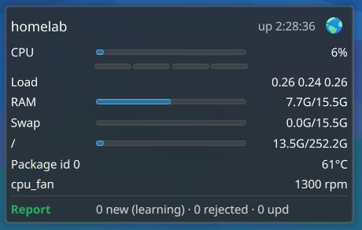

# Glances Monitor

A KDE Plasma 6 widget that shows the live status of a remote machine through
[Glances](https://github.com/nicolargo/glances)' REST API: CPU, memory, swap,
load, file systems, disk I/O, network, sensors, GPU, containers and Glances
AMPs, coloured by Glances' own alert thresholds.

One widget instance watches one server; add it several times for several
machines.



## Features

- **Panel view**: an icon plus the metrics you pick (CPU %, RAM used, load,
  temperature, network rate). On vertical panels the values stack.
- **Status colour**: the icon and text take the *worst* alert level Glances
  reports for the shown values (`WARNING` → neutral, `CRITICAL` → negative),
  turn neutral when an AMP is unhealthy, and negative with "offline" when the
  server stops answering.
- **Popup**: compact one-line rows (label · bar · value) per section, with
  per-core CPU bars and an optional link to a dashboard (e.g. the Glances web UI).
- **Configurable sections**: each one can be switched off; sections whose
  Glances plugin the server does not offer are hidden automatically, and only
  enabled sections are fetched.
- **Filters**: comma-separated glob patterns for mount points, disks, network
  interfaces and sensors.
- **AMPs**: the list is fetched from the server so each AMP can be shown or
  hidden; a regular expression decides which results count as healthy, and
  the matched part can be hidden to keep lines short.

## Requirements

- KDE Plasma 6.0 or newer.
- A Glances 4.x server running in web server mode with REST API v4,
  e.g. `glances -w` (needs the `fastapi` and `uvicorn` Python packages).
  The web UI itself is optional: `glances -w --disable-webui` serves only the API.

## Installation

From a checkout:

```sh
./scripts/install.sh
```

or build a `.plasmoid` file and install it via *Add Widgets… → Get New Widgets
→ Install Widget From Local File*:

```sh
./scripts/build.sh   # writes dist/codes.ender.glances-<version>.plasmoid
```

Plasma loads widget code at startup. After upgrading a widget that is already
on a panel, restart the shell: `plasmashell --replace & disown`.

## Configuration

| Page | Setting | Notes |
|---|---|---|
| General | Glances API URL | e.g. `http://192.0.2.10:61208/api/4` |
| General | Name | empty = the hostname the server reports |
| General | Dashboard link | optional; shown as a button in the popup |
| General | Refresh | 2–60 s (default 5) |
| General | Panel metrics | CPU %, RAM used, load, temperature, network rate |
| Sections | Show … | per section, plus per-core CPU bars |
| Sections | Filters | globs, e.g. `/, /srv*` or `enp*, wlan0`; empty shows all |
| AMPs | Show | one checkbox per AMP defined on the server |
| AMPs | Healthy if result matches | regex, e.g. `^(active|ok) `; empty uses the AMP's own process-count limits |
| AMPs | Hide the matched part | drops the matched text from the displayed line |

### Glances server notes

- Glances 4.5 rejects requests whose `Host` header is not listed in
  `webui_allowed_hosts` (`[outputs]` in `glances.conf`) when that key is set.
  Include the address or name used in the widget's API URL.
- The widget is not a browser, so `cors_origins` does not affect it; keep CORS
  restricted for the web UI's sake.
- Glances running as an unprivileged user cannot read other users' per-process
  I/O counters; consider `disable_stats=io_counters` under `[processlist]`.

## Security

The widget talks plain HTTP(S) to the API URL and **does not support Glances'
`--password` authentication** (Plasma widget settings are stored in plain
text, so a password there would not be kept safely). Expose the Glances API
only on a trusted network or VPN, ideally restricted to the machines running
the widget by a firewall. Glances data includes process lists and command
lines.

## Limitations

- Plasma 6 only.
- No authentication (see above).
- Texts are wrapped in `i18n()` but no translations exist yet.

## License

GPL-2.0-or-later. See [LICENSE](LICENSE).
